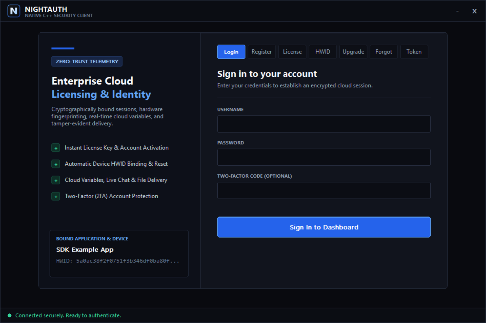
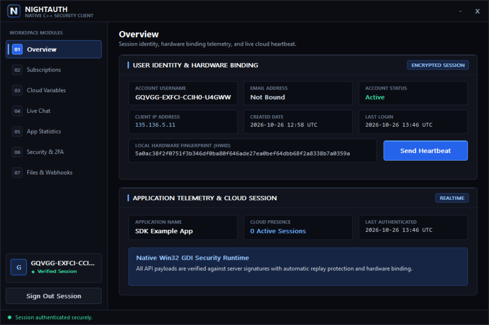
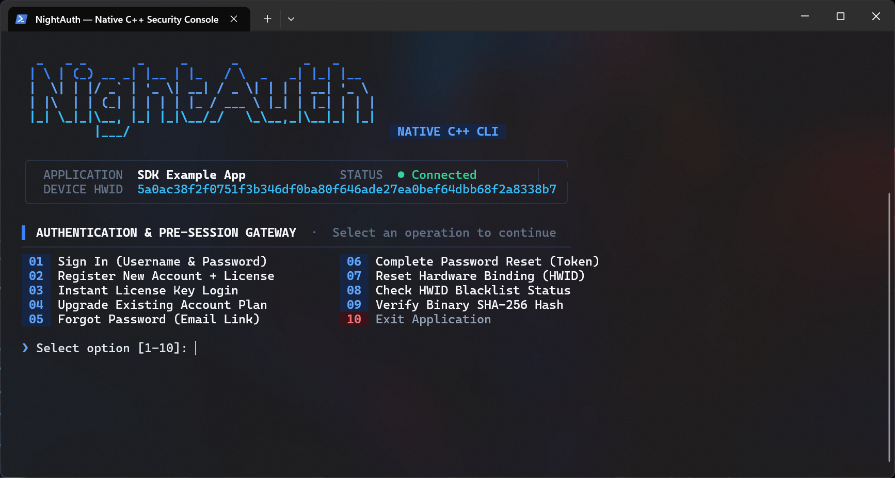
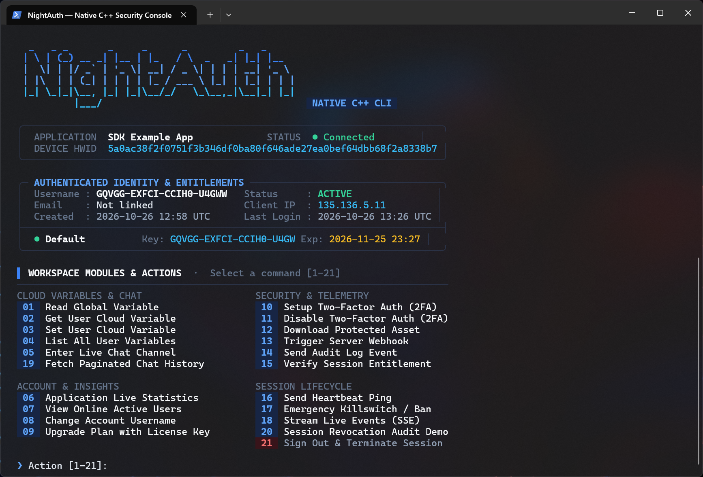

# NightAuth C++ SDK — Dodaj gwiazdkę na GitHub ⭐

Oficjalny pakiet **NightAuth** C++17 Header-Only SDK i zestaw aplikacji referencyjnych (Nowoczesny interfejs graficzny **Win32 Pure GDI+** oraz interaktywny terminal CLI). Zabezpiecz swoje oprogramowanie w C++ przed inżynierią wsteczną i piractwem w kilka minut.

Official Portal: [https://nightauth.org](https://nightauth.org)
---

**Languages / Idiomas / Langues / Sprachen:**  
[English](../README.md) • [Español](es.md) • [Français](fr.md) • [Deutsch](de.md) • [Italiano](it.md) • [Português](pt.md) • [Русский](ru.md) • [Türkçe](tr.md) • [Polski](pl.md) • [中文](zh.md)

---

> [!NOTE]
> ### 📺 Poradniki wideo i instrukcje konfiguracji
> Oficjalne poradniki wideo i przewodniki krok po kroku opisujące konfigurację aplikacji, planów, subskrypcji, zmiennych chmurowych, webhooków i licencji w panelu NightAuth **zostaną wkrótce opublikowane**.

---

## 📸 Zrzuty ekranu

### Aplikacja Pulpitowa (Natywna Win32 GDI+ Nowoczesny Ciemny Motyw)

| Ekran logowania i autoryzacji | Panel zarządzania i subskrypcji |
| :---: | :---: |
|  |  |

### Aplikacja konsolowa (Interaktywny terminal CLI)

| Logowanie w terminalu | Panel interaktywny w konsoli |
| :---: | :---: |
|  |  |

---

## 🛡️ Zalecane Praktyki Bezpieczeństwa

* **Wirtualizacja Plików Binarnych:** Natywne pliki binarne C++ podlegają analizie statycznej za pomocą IDA Pro, Ghidra i Binary Ninja. W wersjach produkcyjnych zabezpieczaj skompilowane pliki wykonywalne za pomocą komercyjnych wirtualizatorów, takich jak **VMProtect**, **Themida** lub **CodeVirtualizer**.
* **Szyfrowanie Ciągów Znaków w Czasie Kompilacji:** Nie pozostawiaj poufnych ciągów znaków ani tokenów API jako zwykłego tekstu w sekcji `.rdata`. Używaj szablonów zaciemniania XOR w czasie kompilacji (np. `skCrypter` lub własnych koderów constexpr), aby odszyfrowywać ciągi tylko w momencie ich użycia.
* **Bezpieczne Wykonywanie Plików w Pamięci:** Podczas pobierania chronionych ładunków lub bibliotek DLL przez `NightAuthApp.downloadFile(fileId, buffer)`, **nigdy nie zapisuj bajtów na dysku fizycznym**. Ładuj i wykonuj je bezpośrednio w pamięci RAM (np. reflective PE lub manual mapping) oraz natychmiast wyczyść bufor za pomocą `SecureZeroMemory()` lub `std::fill`.
* **Weryfikacja Sprzętu i Integralności:** Utrzymuj aktywne mechanizmy anti-debugging, sprawdzanie integralności pamięci i pomiary czasu w wersjach produkcyjnych.

---

## 📦 Wymagania i Kompilacja

Wymaga **C++17** lub nowszego oraz **Visual Studio 2022 / 2026**. Dołączone pliki `.vcxproj` domyślnie używają zestawu narzędzi MSVC `v145`; `v143` jest również obsługiwany.

Zależności w systemie Windows:
* `ws2_32.lib`, `crypt32.lib`, `bcrypt.lib`, `advapi32.lib` (Natywna kryptografia i gniazda Windows)
* `gdi32.lib`, `msimg32.lib`, `comctl32.lib`, `user32.lib`, `shell32.lib` (Renderowanie interfejsu graficznego)
* Dołączone `libcurl` i `OpenSSL` (lub natywne gniazda HTTPS platformy), importowane z `deps/curl_win64` jako `libcurl.dll.a;libcrypto.a;libssl.a`, ze ścieżką include wskazującą na `deps/curl_win64/curl-8.23.0_5-win64-mingw/include`

> [!IMPORTANT]
> Wdrażając kompilację powiązaną z dołączonym `libcurl`, dołącz `libcurl-x64.dll` obok pliku wykonywalnego.

### Budowanie rozwiązania za pomocą MSBuild

```bash
MSBuild.exe NightAuth.sln /p:Configuration=Release /p:Platform=x64
```

---

## ⚙️ Konfiguracja i inicjalizacja

Skonfiguruj dane uwierzytelniające aplikacji z panelu NightAuth:

```cpp
#define NIGHTAUTH_IMPLEMENTATION
#include "sdk/nightauth.hpp"

// Define your application credentials from the Manage Apps tab of the NightAuth dashboard
NightAuth::Api NightAuthApp(
    /* name    */ "",
    /* apikey  */ "",
    /* version */ "1.0",
    /* token   */ ""
);
```

### Inicjalizacja uzgadniania kryptograficznego (`init`)

Wywołaj `init()` przed wszelkimi innymi operacjami. Tworzy wymianę kluczy Diffie-Hellmana (X25519) i szyfrowaną sesję. Przed `init()` należy skonfigurować transport (zobacz [Niestandardowe transporty](#25-custom-transports--server-key-pinning)); najprościej użyć dołączonych helperów libcurl:

```cpp
NightAuthApp.setTransport(NightAuth::Api::makeCurlTransport(NightAuthApp.api_url));
NightAuthApp.setStreamTransport(NightAuth::Api::makeCurlStreamTransport(NightAuthApp.api_url));

NightAuthApp.init();

if (!NightAuthApp.response.success) {
    std::cerr << "Initialization failed: " << NightAuthApp.response.message << "\n";
    return 1;
}
```

---

## 🚀 Przewodnik po SDK

### 1. Sprawdzenie sesji i czarna lista

```cpp
// Validate active session status with the server
if (NightAuthApp.check()) {
    std::cout << "Session active.\n";
}

// Check if client HWID or IP address is blacklisted
if (NightAuthApp.checkBlacklist()) {
    std::cerr << "Access Denied: Machine or IP is blacklisted.\n";
    return 1;
}
```

### 2. Logowanie loginem i hasłem (oraz 2FA)

```cpp
if (NightAuthApp.login(username, password, totpCode)) {
    std::cout << "Welcome back, " << NightAuthApp.user.username << "!\n";
    std::cout << "Hardware ID: " << NightAuthApp.user.hwid << "\n";
    std::cout << "Client IP:   " << NightAuthApp.user.ip << "\n";

    for (const auto& sub : NightAuthApp.user.subscriptions) {
        std::cout << "Plan: " << sub.subscription << " | Expires: " << sub.expiry << " | Key: " << sub.key << "\n";
    }
} else {
    std::cerr << "Login failed: " << NightAuthApp.response.message << "\n";
}
```

### 3. Rejestracja z kluczem licencyjnym

```cpp
if (NightAuthApp.registerAccount(username, password, licenseKey, email)) {
    std::cout << "Registered successfully: " << NightAuthApp.user.username << "\n";
} else {
    std::cerr << "Registration failed: " << NightAuthApp.response.message << "\n";
}
```

### 4. Dostęp tylko z kluczem (Key Only)

```cpp
if (NightAuthApp.license(licenseKey)) {
    std::cout << "License verified successfully. Access granted.\n";
} else {
    std::cerr << "Access denied: " << NightAuthApp.response.message << "\n";
}
```

### 5. Aktualizacja subskrypcji / Użycie klucza (Upgrade)

```cpp
if (NightAuthApp.upgrade(username, newLicenseKey)) {
    std::cout << "Subscription upgraded successfully.\n";
} else {
    std::cerr << "Upgrade failed: " << NightAuthApp.response.message << "\n";
}
```

### 6. Reset identyfikatora sprzętowego (HWID Lock)

```cpp
if (NightAuthApp.resetHwid(username, password, totpCode)) {
    std::cout << "HWID reset successfully. You can now log in on this machine.\n";
} else {
    std::cerr << "HWID reset failed: " << NightAuthApp.response.message << "\n";
}
```

### 7. Przypomnienie hasła (Forgot Password & Reset)

```cpp
// Request password reset email
if (NightAuthApp.forgotPassword(email)) {
    std::cout << "Password recovery email sent. Check your inbox.\n";
}

// Complete password reset with token
if (NightAuthApp.resetPassword(token, newPassword)) {
    std::cout << "Password reset successfully.\n";
}
```

### 8. Dane profilu użytkownika (`result.ToUserData()`)

```cpp
const NightAuth::UserData& user = NightAuthApp.user;

std::cout << "Username:    " << user.username << "\n";
std::cout << "Client IP:   " << user.ip << "\n";
std::cout << "Hardware ID: " << user.hwid << "\n";
std::cout << "Registered:  " << user.created_at << "\n";
std::cout << "Last Login:  " << user.last_login_at << "\n";

for (const auto& sub : user.subscriptions) {
    std::cout << "Plan: " << sub.subscription << " | Expires: " << sub.expiry << " | Key: " << sub.key << "\n";
}
```

### 9. Zmienne w chmurze (Globalne)

```cpp
std::string motd = NightAuthApp.getGlobalVar("server_motd");
std::cout << "Cloud Variable: " << motd << "\n";
```

### 10. Zmienne użytkownika (User Variables)

```cpp
// Set a user variable
bool setOk = NightAuthApp.setUserVar("discord_tag", "user#0001");

// Retrieve a user variable
std::string tag = NightAuthApp.getUserVar("discord_tag");
std::cout << "Stored Discord: " << tag << "\n";

// Retrieve all user variables
std::vector<std::pair<std::string, std::string>> allVars;
if (NightAuthApp.getUserVariables(allVars)) {
    for (const auto& kv : allVars) {
        std::cout << kv.first << " = " << kv.second << "\n";
    }
}
```

### 11. Dziennik audytu aplikacji

```cpp
NightAuthApp.log("Suspicious memory modification attempt detected.");
```

### 12. Blokowanie użytkownika i urządzenia

```cpp
NightAuthApp.ban("Security tampering detected by Anti-Cheat.");
```

### 13. Webhooki po stronie serwera

```cpp
NightAuth::WebhookResult res;
std::string payload = "{\"content\":\"Client notification\"}";

if (NightAuthApp.triggerWebhook("7kR0UedlVI", payload, res)) {
    std::cout << "Webhook Response: HTTP " << res.status << "\n";
}
```

Aby załączyć plik, użyj przeciążenia przyjmującego `NightAuth::WebhookOptions` (plik jest wysyłany jako multipart/form-data):

```cpp
NightAuth::WebhookOptions options;
options.hasFile = true;
options.fileName = "report.bin";
options.fileData = fileBytes; // raw file content

if (NightAuthApp.triggerWebhook("7kR0UedlVI", payload, res, options)) {
    std::cout << "Webhook with attachment delivered: HTTP " << res.status << "\n";
}
```

### 14. Bezpieczne pobieranie plików w pamięci

```cpp
std::string fileBuffer;

if (NightAuthApp.downloadFile("385624", fileBuffer)) {
    std::cout << "Downloaded " << fileBuffer.size() << " bytes securely.\n";
    // Process or execute payload directly in memory (Reflective PE / Shellcode)
    // Securely wipe memory buffer after execution
    SecureZeroMemory(fileBuffer.data(), fileBuffer.size()); // Windows-only (Win32)
}
```

> [!NOTE]
> `SecureZeroMemory()` to API Win32. Do przenośnego czyszczenia użyj `std::fill(buffer.begin(), buffer.end(), '\0')` lub `OPENSSL_cleanse(buffer.data(), buffer.size())` (OpenSSL jest już połączony).

### 15. Kanały czatu na żywo

```cpp
// Send a message to a channel
NightAuthApp.sendChatMessage("Hello community!", "general");

// Fetch latest messages
std::vector<NightAuth::ChatMessage> messages = NightAuthApp.getChatMessages("general");
for (const auto& msg : messages) {
    std::cout << "[" << msg.author << "]: " << msg.message << "\n";
}
```

### 16. Obsługa zdarzeń w czasie rzeczywistym (SSE)

Zasubskrybuj strumień zdarzeń serwera za pomocą callbacku przyjmującego `NightAuth::EventMessage` (pola: `id`, `type`, `data`). Callback musi zwracać `bool`: zwróć `false`, aby przestać słuchać. Najpierw należy skonfigurować transport strumieniowy (zobacz `setStreamTransport` w [Niestandardowe transporty](#25-custom-transports--server-key-pinning)):

```cpp
std::atomic<bool> cancelStream{false};

NightAuthApp.subscribeEvents([](const NightAuth::EventMessage& ev) {
    std::cout << "[EVENT] " << ev.id << " " << ev.type << ": " << ev.data << "\n";
    return true; // return false to stop the stream
}, &cancelStream);
```

Możesz też reagować na powiadomienia cyklu życia, przypisując callbacki dostępne w instancji `Api`:

```cpp
NightAuthApp.onSessionInvalidated = [](const std::string& reason) { /* session revoked */ };
NightAuthApp.onAppBanned          = [](const std::string& reason) { /* app banned */ };
NightAuthApp.onAppStatusChanged   = [](const std::string& status) { /* "app-paused" / "app-disabled" */ };
NightAuthApp.onVersionUpdated     = [](const std::string& version) { /* new version available */ };
NightAuthApp.onChatMessageReceived = [](const NightAuth::ChatMessage& msg, const std::string& room) { /* chat message */ };
```

### 17. Uwierzytelnianie dwuskładnikowe (2FA)

```cpp
// Setup TOTP 2FA
NightAuth::TwoFactorSetupData setup;
if (NightAuthApp.setup2FA(setup)) {
    std::cout << "2FA Secret: " << setup.secret << "\n";
    std::cout << "QR URI:     " << setup.uri << "\n";
}

// Confirm with 6-digit Authenticator code
NightAuth::TwoFactorConfirmData conf;
NightAuthApp.confirm2FA("123456", conf);

// Disable 2FA
NightAuthApp.disable2FA(password, "123456");
```

### 18. Cykl życia sesji i wylogowanie

```cpp
// Heartbeat ping to keep session alive
NightAuthApp.heartbeat();

// Revoke and terminate session
NightAuthApp.logout();

// Wipe all local session state (keys, user, app data) without a server call.
// Also called automatically by the destructor.
NightAuthApp.close();
```

### 19. Zmiana Nazwy Użytkownika

Zmienia nazwę użytkownika zalogowanego konta (sesja zostaje zamknięta ze względów bezpieczeństwa):

```cpp
if (NightAuthApp.changeUsername("new_username", password)) {
    std::cout << "Username updated: " << NightAuthApp.user.username << "\n";
    // For security, the session is closed: sign in again with the new username.
}
```

### 20. Statystyki Aplikacji i Użytkownicy Online

Pobiera zagregowane statystyki aplikacji i listę użytkowników z aktywną sesją:

```cpp
NightAuth::AppStats stats;
if (NightAuthApp.getStats(stats)) {
    std::cout << "Users: " << stats.total_users << " (active " << stats.active_users
              << ", banned " << stats.banned_users << ")\n";
    std::cout << "Licenses: " << stats.total_licenses << " (used " << stats.used_licenses
              << ", unused " << stats.unused_licenses << ")\n";
    std::cout << "Version: " << stats.version << "\n";
}

for (const auto& u : NightAuthApp.getOnlineUsers()) {
    std::cout << "Online: " << u << "\n";
}
```

Liczniki na poziomie aplikacji są dostępne bezpośrednio na instancji jako `NightAuthApp.app` (`NightAuth::AppData` z polami `total_users`, `online_users`, `total_keys`, `version`). Aliasy `user_data` / `app_data` odwołują się do tych samych pól `user` / `app`.

### 21. Bilety Dostępu

Żąda krótko żyjącego biletu upoważniającego do operacji w danym zakresie (używanego wewnętrznie przez `downloadFile` i `subscribeEvents`):

```cpp
NightAuth::AccessTicket ticket;
if (NightAuthApp.requestAccessTicket("file", "385624", ticket)) {
    std::cout << "Ticket: " << ticket.ticket << " (expires in " << ticket.expires_in << "s)\n";
}
```

### 22. Weryfikacja Hasha Pliku

Weryfikuje szesnastkowy skrót SHA-256 względem wartości zarejestrowanych po stronie serwera:

```cpp
if (NightAuthApp.verifyFileHash(sha256Hex)) {
    std::cout << "Hash verified.\n";
}
```

### 23. Zarządzanie HWID

SDK automatycznie wyprowadza identyfikator sprzętowy (hostname + nazwa użytkownika, z haszem). Można go nadpisać lub wyczyścić dla instancji:

```cpp
NightAuthApp.setHardwareId("my-custom-hwid"); // send this HWID on login/register/license
NightAuthApp.clearHardwareId();               // revert to automatic derivation
```

Statyczne helpery w `NightAuth::SecurityProtections`:

```cpp
std::string hwid = NightAuth::SecurityProtections::getHardwareId();
NightAuth::SecurityProtections::setHardwareIdOverride("shared-hwid");
NightAuth::SecurityProtections::runSecurityChecks();   // reserved integrity hooks
NightAuth::SecurityProtections::checkSystemProxy();    // reserved proxy checks
```

### 24. Podpisane Aktualizacje

Niepodpisana automatyczna aktualizacja jest wyłączona: `applyUpdate()` zawsze kończy się niepowodzeniem. Dystrybuuj podpisane manifesty wydań i weryfikuj je za pomocą `SignedUpdate` / `SignedUpdateInstaller`:

```cpp
// One-shot: fetch the manifest, verify its Ed25519 signature against your pinned
// release key, enforce the stored sequence (anti-rollback), download to a temp
// file and verify its SHA-256 digest. Returns the destination path.
std::string path = NightAuthApp.downloadSignedUpdate(
    "https://example.com/releases/manifest.json",
    pinnedReleaseKeyHex,           // 64 hex chars (32 bytes)
    "C:\\Updates\\MyApp.exe");

// Manual pipeline for full control:
NightAuth::VerifiedUpdate v = NightAuth::SignedUpdate::verify(envelopeJson, pinnedReleaseKeyHex, "MyApp");
NightAuth::SignedUpdate::download(v, "C:\\Updates\\MyApp.exe");

// Sequence storage location (per-application .seq file used for rollback protection):
std::string seqPath = NightAuth::SignedUpdateInstaller::getSequencePath("MyApp");
```

`NightAuth::VerifiedUpdate` udostępnia `application`, `version`, `sequence`, `url`, `size`, `expiresAt` oraz `digest` (bajty SHA-256).

### 25. Niestandardowe Transporty i Przypinanie Kluczy Serwera

Cały ruch HTTP przechodzi przez wymienne transporty. Dołączone helpery libcurl są domyślnym wyborem; zwykły HTTP jest odrzucany poza dokładnymi hostami loopback z wyraźną zgodą:

```cpp
NightAuthApp.setTransport(NightAuth::Api::makeCurlTransport(
    NightAuthApp.api_url, /*allowInsecureLoopback*/ false,
    /*connectTimeoutMs*/ 10000, /*totalTimeoutMs*/ 30000,
    /*maxResponseBytes*/ 5 * 1024 * 1024));

NightAuthApp.setStreamTransport(NightAuth::Api::makeCurlStreamTransport(NightAuthApp.api_url));
```

Aby hostować samodzielnie lub rotować klucze, przypnij własne klucze podpisu / sealed-box serwera przed `init()` (oba muszą mieć 64 znaki hex):

```cpp
if (!NightAuthApp.setServerKeys(signingKeyHex, sealedBoxKeyHex)) { /* invalid key format */ }
```

Wartości domyślne są udostępniane jako stałe i składowe statyczne: `NightAuth::DEFAULT_API_URL`, `NightAuth::DEFAULT_SIGNING_PUBLIC_KEY`, `NightAuth::DEFAULT_SEALED_BOX_PUBLIC_KEY`, `NightAuth::Api::ServerSigningPublicKey` oraz `NightAuth::Api::ServerSealedBoxPublicKey`.

---

## 🖥️ Uruchamianie aplikacji konsoli i pulpitu

```bash
# Build Solution
MSBuild.exe NightAuth.sln /p:Configuration=Release /p:Platform=x64

# Interactive Terminal Console Client
./console/bin/Release/NightAuth-Console.exe

# Native Modern Win32 Desktop GUI Client
./desktop/bin/Release/NightAuth-Desktop.exe
```

---

## 📄 Licencja

Projekt jest licencjonowany na warunkach **Elastic License 2.0**.

* Nie wolno udostępniać oprogramowania osobom trzecim jako usługi hostowanej lub zarządzanej.
* Nie wolno modyfikować, wyłączać ani omijać funkcji weryfikacji licencji.
* Nie wolno usuwać ani modyfikować informacji o prawach autorskich.

Pełny tekst znajduje się w pliku [LICENSE](../LICENSE).
